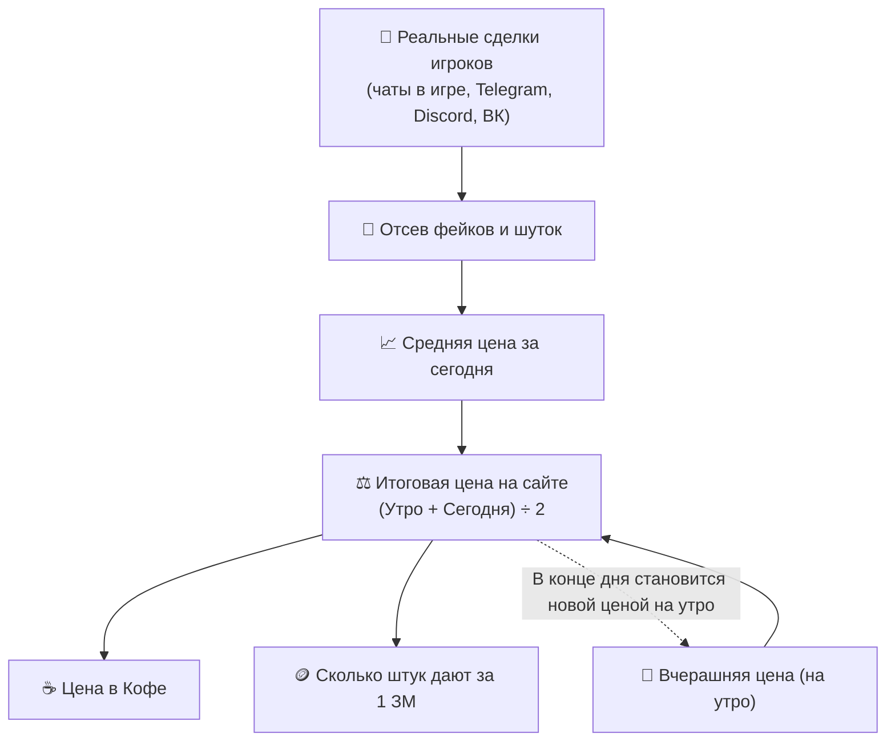

# RR4-Barter
### 🎣 РР4-Бартер — справочник цен и биржа лотов для «Русской Рыбалки 4»

Сделал этот сайт, чтобы каждый мог быстро узнать реальную рыночную стоимость наживок, живца и филе и не тратить время на поиск по чатам и группам. Все курсы отображаются напрямую из базы, которая обновляется по реальным сделкам игроков без шуточных объявлений.

* 🌐 **Сам сайт тут:** [daedalusie.github.io/RR4-Barter/](https://daedalusie.github.io/RR4-Barter/)
* 💬 **Телеграм группа:** https://t.me/+MGo4_xwWBIIyNzEy
* 📩 **Связь со мной:** https://t.me/@AAAAAUAQ

---

### ✨ Что уже работает

* **Актуальные цены в Кофе и ЗМ.** Таблица автоматически считает курс и показывает время последнего обновления по каждому предмету в вашем часовом поясе.
* **Биржа бартерных лотов.** Игроки могут выставлять свои лоты на покупку, продажу или обмен (на Кофе, ЗМ или другую наживку) с автоматическим расчётом выгоды относительно цены сайта и статусом «Онлайн / Офлайн».
* **4-часовые графики динамики цен.** Слева отображаются ТОП-3 самых активных позиции. При клике открывается подробный график со средней ценой (Кофе / ЗМ), количеством сделок за каждые 4 часа и зумом.
* **Калькулятор обмена.** Достаточно кликнуть по нужной строке в таблице и ввести количество штук — сайт сразу посчитает итог в Кофе и ЗМ.
* **Поиск и фильтры без тормозов.** Быстрый поиск по названию, фильтр по категориям, скрытие позиций без цены и сортировка по стоимости или свежести.
* **Адаптация под смартфоны.** Удобно сверять цены, смотреть графики и подавать лоты с телефона прямо во время рыбалки.

---

### 🚀 Что планирую доделать дальше

1. **Уведомления в Telegram о новых лотах** для быстрой модерации заявок.
2. **Расширенные фильтры в общем списке лотов** (по типу сделки и статусу онлайна продавца) и копирование ника в один клик.
3. **Открытие графика по клику на любую строку** основной таблицы цен.

### 📊 Как считаются цены на сайте (простыми словами)

Чтобы курс не прыгал из-за одного случайного или шуточного объявления в чате, сайт считает цены **плавно** — как на настоящей бирже.

#### Разберём на простом примере (Медведка):
1. **Утром** Медведка стоила **100 Кофе**.
2. **Днём** игроки провели несколько сделок, и средняя цена за сегодня получилась **110 Кофе**.
3. **На сайте** показывается середина между утренней и дневной ценой: `(100 + 110) ÷ 2 =` **105 Кофе**.
   * *Зачем так?* Если кто-то один в чате в шутку напишет «куплю медведку по 500 кофе», цена на сайте не улетит в космос, а сдвинется плавно и честно.
4. **Вечером** торговый день закрывается: итоговые **105 Кофе** запоминаются как новая утренняя цена на завтра.
5. **Пересчёт в Золотые монеты (ЗМ):** если 1 ЗМ сейчас стоит **4250 Кофе**, а Медведка — **105 Кофе**, сайт сам делит `4250 ÷ 105` и показывает: **40 штук за 1 ЗМ**.
