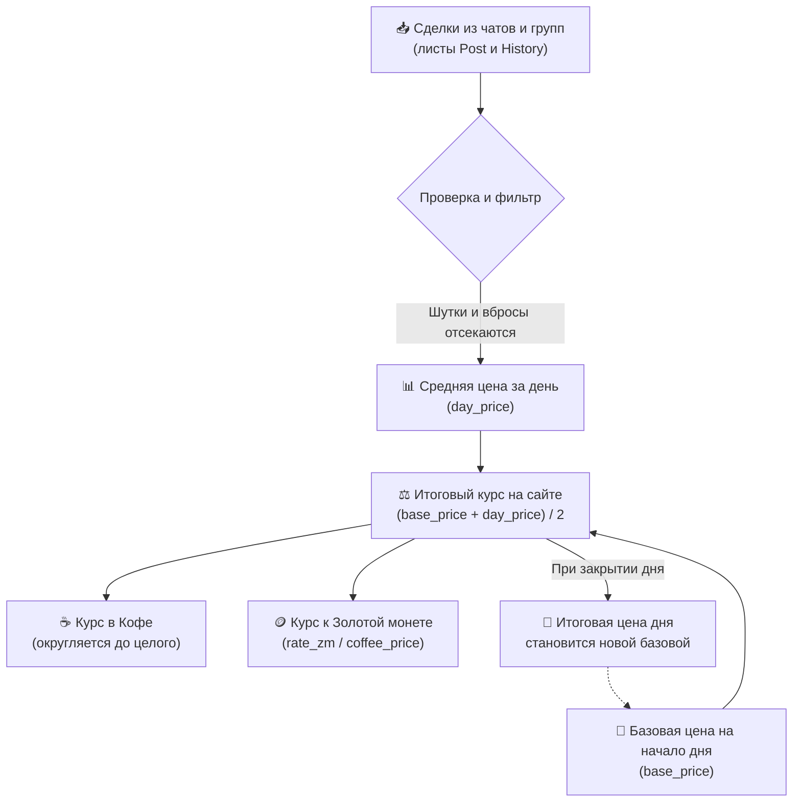

# RR4-Barter
### 🎣 РР4-Бартер — справочник цен и биржа лотов для «Русской Рыбалки 4»

Сделал этот сайт, чтобы каждый мог быстро узнать реальную рыночную стоимость наживок, живца и филе и не тратить время на поиск по чатам и группам. Все курсы отображаются напрямую из базы, которая обновляется по реальным сделкам игроков без шуточных объявлений.

* 🌐 **Сам сайт тут:** [daedalusie.github.io/RR4-Barter/](https://daedalusie.github.io/RR4-Barter/)
* 💬 **Телеграм группа:** https://t.me/+MGo4_xwWBIIyNzEy
* 📩 **Связь со мной:** https://t.me/@AAAAAUAQ

---

### ✨ Что уже работает

* **Актуальные цены в Кофе и ЗМ.** Таблица автоматически считает курс и показывает время последнего обновления по каждому предмету в вашем часовом поясе.
* **Биржа бартерных лотов.** Игроки могут выставлять свои лоты на покупку, продажу или обмен (на Кофе, ЗМ или другую наживку) с автоматическим расчётом выгоды относительно цены сайта и статусом «Онлайн / Офлайн».
* **4-часовые графики динамики цен.** Слева отображаются ТОП-3 самых активных позиции. При клике открывается подробный график со средней ценой (Кофе / ЗМ), количеством сделок за каждые 4 часа и зумом.
* **Калькулятор обмена.** Достаточно кликнуть по нужной строке в таблице и ввести количество штук — сайт сразу посчитает итог в Кофе и ЗМ.
* **Поиск и фильтры без тормозов.** Быстрый поиск по названию, фильтр по категориям, скрытие позиций без цены и сортировка по стоимости или свежести.
* **Адаптация под смартфоны.** Удобно сверять цены, смотреть графики и подавать лоты с телефона прямо во время рыбалки.

---

### 🚀 Что планирую доделать дальше

1. **Уведомления в Telegram о новых лотах** для быстрой модерации заявок.
2. **Расширенные фильтры в общем списке лотов** (по типу сделки и статусу онлайна продавца) и копирование ника в один клик.
3. **Открытие графика по клику на любую строку** основной таблицы цен.

### 📊 Как работает ценообразование (схема расчёта)

Чтобы цены на сайте не скакали от единичных шуточных объявлений, в таблице используется **двухэтапное сглаживание** и пересчёт через актуальный курс Золотой монеты (ЗМ):

#### Коротко по шагам:
1. **Сбор реальных сделок:** из игрового чата, Telegram, Discord и ВК фиксируются только реальные сделки (цена за штуку в Кофе или ЗМ).
2. **Защита от резких скачков:** в течение дня средняя дневная цена (`day_price`) усредняется с текущей базовой ценой (`base_price`) по формуле **`(База + День) / 2`**.
3. **Закрытие торгового дня:** в конце дня итоговая усреднённая цена перезаписывается как новая базовая (`base_price`), от которой плавно начинается следующий день.
4. **Пересчёт в Золотые монеты (ЗМ):** соотношение каждой наживки к 1 ЗМ рассчитывается автоматически от актуального рыночного курса Золотой монеты в Кофе.
5. **Индексы рынка:** показывают в реальном времени, на сколько процентов текущие цены наживок и голд-наживок выше или ниже базовых.
